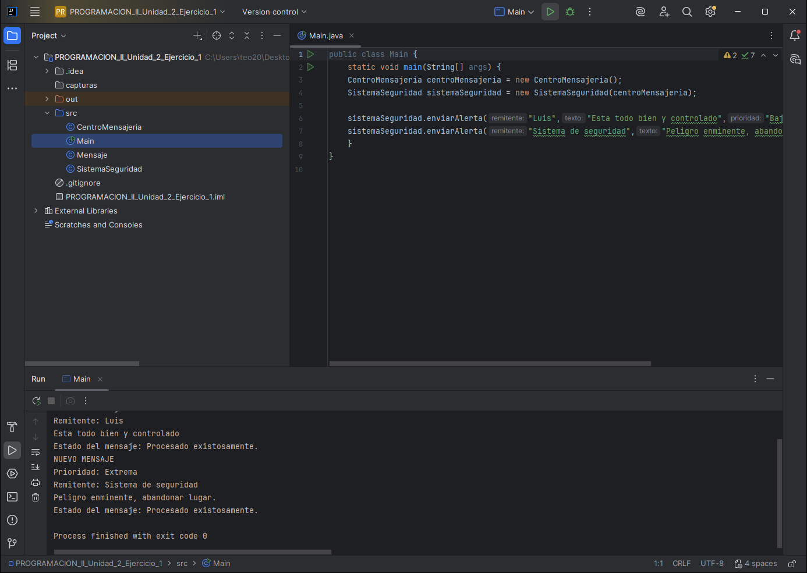

# PROGRAMACIÓN II — Unidad 2, Ejercicio 1: El Centro de Notificaciones

Trabajo práctico de Programación II. Este repositorio contiene la resolución en Java del ejercicio 1 de la Unidad 2.

## Consigna

#### Contexto

En una aplicación de gestión empresarial, los distintos módulos del sistema necesitan informar eventos importantes a los usuarios (como alertas de seguridad o avisos de pago). Para lograr esto de manera desacoplada, los objetos emisores deben enviar mensajes a un objeto centralizador de notificaciones que se encarga de procesarlas y entregarlas.

#### Consigna

Diseñar un sistema en Java donde un objeto emisor (por ejemplo, una clase SistemaSeguridad) se comunique con un objeto receptor (CentroMensajeria) enviándole mensajes a través de invocaciones a métodos, pasando parámetros complejos.

#### Desarrollo requerido

- Definir la clase Mensaje con atributos como remitente, texto y prioridad.
- Crear la clase CentroMensajeria que contenga un método recibirMensaje(Mensaje m) para procesar las comunicaciones entrantes.
- Implementar la clase SistemaSeguridad que posea una referencia a un CentroMensajeria y un método que dispare el envío de una alerta.
- En el método main, instanciar el centro, el sistema de seguridad, simular el envío de al menos dos mensajes y mostrar el estado de la comunicación por consola.

## Estructura del repositorio

```
PROGRAMACION_II_Unidad_2_Ejercicio_1/
├── README.md
├── capturas/
│   └── consola.png
└── src/
    ├── CentroMensajeria.java
    ├── Main.java   # clase con el método main
    ├── Mensaje.java
    └── SistemaSeguridad.java
```

## Funcionamiento y lógica

El ejercicio muestra la **colaboración entre objetos**: un objeto emisor no procesa el mensaje por su cuenta, sino que se lo envía a otro objeto que se encarga de procesarlo.

### `Mensaje`

Agrupa los datos de una notificación: `remitente`, `texto` y `prioridad`, todos privados y con sus getters.

### `CentroMensajeria`

Es el objeto **receptor**. Su método `recibirMensaje(Mensaje m)` toma el mensaje y muestra por consola su prioridad, el remitente, el texto y que fue procesado.

### `SistemaSeguridad`

Es el objeto **emisor**. Recibe en el constructor una referencia al `CentroMensajeria` y la guarda como atributo (asociación entre objetos). Su método `enviarAlerta(remitente, texto, prioridad)` arma un objeto `Mensaje` con esos datos y se lo envía al centro llamando a `recibirMensaje()`.

### `Main`

Crea el centro de mensajería y el sistema de seguridad conectado a él, y envía dos alertas: una de prioridad **Baja** de "Luis" y otra **Extrema** del "Sistema de seguridad". Cada una aparece procesada por el centro en la consola.

## Ejecución

Captura de la consola de IntelliJ IDEA ejecutando el programa:



Salida obtenida:

```
NUEVO MENSAJE
Prioridad: Baja
Remitente: Luis
Esta todo bien y controlado
Estado del mensaje: Procesado existosamente.
NUEVO MENSAJE
Prioridad: Extrema
Remitente: Sistema de seguridad
Peligro enminente, abandonar lugar.
Estado del mensaje: Procesado existosamente.
```
